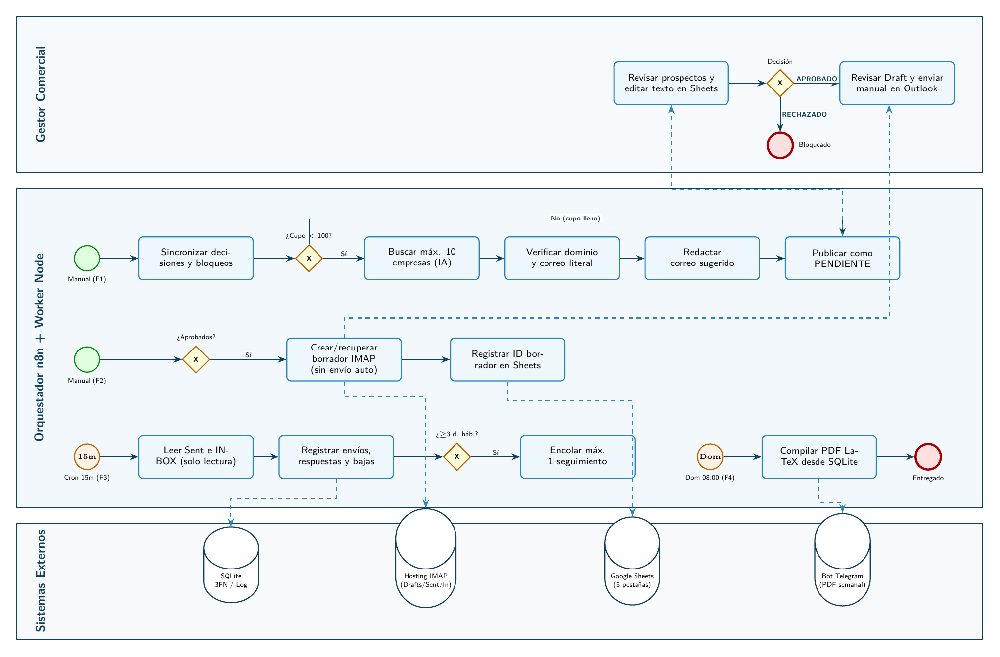
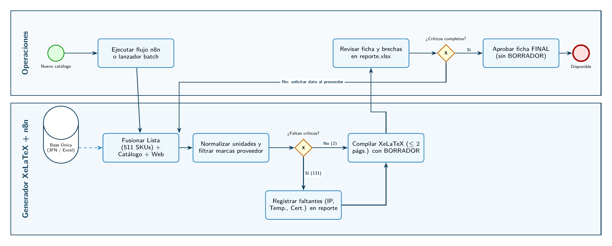

# 02 — Procesos BPMN (AS-IS → TO-BE) y Evolución E1 → E2

Los tres modelos fuente de Bizagi (`Atención a clientes.bpm`, `Búsqueda de clientes.bpm` y `Creación de Fichas Técnicas.bpm`) se conservan en `assets/bpm/` como línea base histórica de la Entrega 1. A continuación se documentan los diagramas **TO-BE finales de la Entrega 2**, explicando cada cambio respecto de E1 y su trazabilidad directa con los flujos implementados.

---

## 1. Proceso 1: Prospección y Búsqueda de Clientes B2B

- **Base E1:** `assets/busqueda-ASIS.png` y `assets/busqueda-TOBE.png`.
- **TO-BE final E2:** 

### Cambios clave respecto de la Entrega 1
1. **Desacoplamiento en 4 flujos n8n orquestados (vs. un flujo único lineal en E1):**
   - **Flujo 1 (`01_prospeccion.json`):** Antes de buscar empresas nuevas, lee primero las decisiones humanas de Sheets (`PENDIENTE`/`APROBADO`/`RECHAZADO`), aplica bloqueos y calcula el cupo disponible respecto al tope de **100 pendientes**. Solo si `slots > 0`, invoca la búsqueda con IA (máx. 10) y verifica que el correo aparezca literalmente en el HTML del mismo dominio.
   - **Flujo 2 (`02_borradores.json`):** Toma exclusivamente filas `APROBADO` y crea borradores vía **IMAP** en la carpeta `Drafts` (con `Message-ID` determinista para evitar duplicados ante cortes).
   - **Flujo 3 (`03_seguimiento.json`, cron `*/15 * * * *`):** Monitorea `Sent` e `INBOX` en modo solo lectura. Registra envíos manuales hechos desde Outlook, distingue respuestas humanas de respuestas automáticas (`AUTO`), detecta rebotes (`BOUNCE`) y bajas (`BAJA_OPTOUT` → bloqueo permanente), y encola **como máximo 1 seguimiento** en estado `PENDIENTE` tras **3 días hábiles** sin respuesta.
   - **Flujo 4 (`04_resumen.json`, cron domingos `08:00` CL):** Consolida métricas desde SQLite (sin llamar a la IA), compila el reporte PDF en LaTeX y lo envía por Telegram.
2. **Eliminación de "calificación numérica artificial":** En E1 se proponía un puntaje numérico por prospecto; en E2 se reemplazó por **evidencia web verificada** + **revisión comercial explícita en Google Sheets** (evitando aprobar contactos por puntajes opacos).
3. **Mantenimiento estricto del envío humano (RNF-04):** n8n nunca envía correos vía SMTP; Ariel decide cuándo presionar *Enviar* en Outlook.

---

## 2. Proceso 2: Generación de Fichas Técnicas

- **Base E1:** `assets/fichas-ASIS.png` y `assets/fichas-TOBE.png`.
- **TO-BE final E2:** 

### Cambios clave respecto de la Entrega 1
1. **De flujo por URL individual a consolidación integral de catálogo (`generador/`):**
   - La primera versión en n8n (`Maxilux_Fichas_n8n.json`, 34 nodos) extraía URLs o PDFs individuales mediante reglas pero solo aceptaba 27 de 55 PDFs y creaba códigos correlativos (`MX-CAM-0001`) incompatibles con la lista real (`MX-1000..MX-1510`).
   - El TO-BE final consolida automáticamente la **Lista de Precios (511 SKUs)**, **Catálogo borrador (55 PDFs)** y **catálogos web de 3 proveedores**, aplicando normalización de unidades, corrección de erratas (`LUMIMARIA` → `LUMINARIA`) y **filtro obligatorio anti-fuga de marcas de proveedores**.
2. **Separación automática por IP y marca de agua `BORRADOR`:**
   - Si una familia tiene modelos con distinto IP (p. ej., `IP65` vs `IP66`), el sistema genera fichas separadas.
   - Si falta cualquiera de los 3 atributos críticos (`IP`, `Temperatura de operación`, `Certificaciones`), la ficha se compila con marca de agua `BORRADOR` y registra exactamente qué falta en `reporte.xlsx` y en la vista SQL `v_cobertura_fichas`.
3. **Orquestación desde n8n (`Maxilux_Generar_Fichas.json`):** Permite disparar la regeneración masiva vía `POST http://127.0.0.1:8790/generar`.

---

## 3. Proceso 3: Atención de Consultas y Derivación (Continuidad y Alcance E2)

- **Base E1:** `assets/atencion-ASIS.png` y `assets/atencion-TOBE.png`.
- **Estado en E2:** Se conservan los diagramas `AS-IS` y `TO-BE` de E1 sin alteración estructural en las reglas de negocio (entrada única, consulta a fichas aprobadas, derivación binaria entre Comercial/Operaciones y Finanzas/Proveedores con control de plazo).
- **Materialización en E2:** Durante esta entrega el componente quedó **plenamente modelado y normalizado en la base de datos 3FN** (`consulta_cliente` y `derivacion_consulta`) y cuantificado mediante la consulta `Q7`, demostrando que las consultas sobre productos con ficha `COMPLETA` se resuelven en ~25 min promedio (83,3% resolución autónoma) frente a ~471 min en `BORRADOR` y ~1.419 min en `SIN_RESPALDO`. El despliegue del widget de chat en vivo queda documentado como **extensión natural posterior** una vez completada la aprobación de las fichas críticas pendientes.
