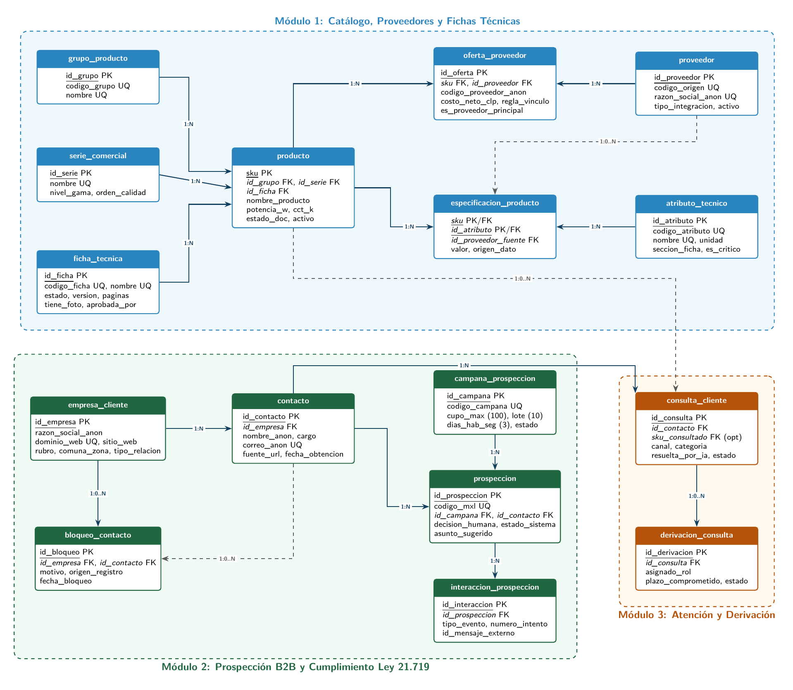

# 03 — Modelo de Datos Normalizado (3FN) y Diccionario de Datos

## 1. Diagnóstico del punto de partida (por qué fue necesario reconstruir el modelo)

Al auditar los artefactos existentes en Maxilux antes de la Entrega 2, se detectaron tres estructuras de datos no normalizadas que generaban anomalías de actualización, duplicidad y pérdida de integridad:

1. **Lista de Precios en Excel (`LISTA DE PRECIOS OCTUBRE 2026.xlsx`):** 10 hojas desconectadas. La fórmula de `ORIGEN` usaba `MINIFS` (proveedor más barato), mientras `COSTO` usaba `=MAX(M:T)` (costo más alto), produciendo una inconsistencia latente en precios de venta al cargar un segundo proveedor. Además, el código `ORIGEN` colisionaba al tomar solo la primera letra del proveedor.
2. **Tabla plana del generador de fichas (`Base de fichas Maxilux.xlsx`):** Una única tabla de **511 filas × 77 columnas** con:
   - **Violación de 1FN:** Grupos repetitivos (`Característica 1` a `Característica 6`).
   - **Violación de 2FN/3FN:** Dependencias transitivas de grupo, serie, proveedor y datos propios de la ficha técnica (`Descripción breve`, `Revisión`, `Fecha`) repetidos en múltiples SKUs, además de 188 filas llenas de celdas `NULL`.
3. **SQLite operativo del worker de prospección (`src/core.mjs`):** Tabla `leads(id TEXT PRIMARY KEY, payload TEXT NOT NULL)` que serializa todo el registro en un objeto **JSON sin atomicidad** (incumple **1FN**), impidiendo consultas SQL relacionales directas, restricciones `FOREIGN KEY` o control declarativo sobre campañas y bloqueos.

---

## 2. Demostración formal de normalización (1FN → 2FN → 3FN)

| Forma Normal | Qué problema existía antes | Cómo se resolvió en `db/schema.sql` (3FN) | Anomalía evitada |
|---|---|---|---|
| **1FN (Atomicidad y sin grupos repetitivos)** | Columnas repetitivas `Característica 1..6` en Excel y blobs JSON en `leads.payload` del worker. | Se eliminó todo JSON y columna enumerada. Cada atributo técnico tiene una fila atómica en `atributo_tecnico` y un único valor por `(sku, id_atributo)` en `especificacion_producto`. Cada interacción IMAP tiene su fila en `interaccion_prospeccion`. | Anomalía de inserción y consulta imposible mediante SQL estándar sin parseo externo. |
| **2FN (Sin dependencias parciales de clave compuesta)** | En una tabla catálogo-proveedor combinada `(sku, id_proveedor)`, los atributos del producto (`nombre_producto`, `potencia_w`, `id_grupo`) dependerían solo de `sku`, no del par completo. | Se separó `producto (sku PK)` de `oferta_proveedor (id_oferta PK, UNIQUE(sku, id_proveedor))` y de `especificacion_producto (PK(sku, id_atributo))`. | Anomalía de actualización: cambiar la potencia o grupo de un SKU no obliga a editar múltiples filas de proveedores ni falla si no tiene proveedor asignado. |
| **3FN (Sin dependencias transitivas ni atributos calculados)** | (a) `ficha_tecnica` almacenaba `grupo` y `criticos_faltantes`; (b) `producto` mezclaba `grupo` + `serie` + `grado_ip` + `costo`/`precio_proyecto`; (c) `prospeccion` mezclaba empresa + contacto + campaña. | (a) `ficha_tecnica` conserva solo atributos intrínsecos de la ficha; la cobertura y faltantes críticos se derivan dinámicamente en la vista `v_cobertura_fichas`. (b) Se extrajeron `grupo_producto`, `serie_comercial`, `proveedor`, `empresa_cliente`, `contacto` y `campana_prospeccion`. Los precios de venta (`×1,65`, `×1,52`, `×1,42`) no se guardan como columnas sino en `v_lista_precios_clientes` usando `MIN(costo_neto_clp)`. | Anomalía de borrado (no se pierde la empresa al descartar una campaña) y anomalía de inconsistencia (imposible tener dos precios desincronizados o costos contradictorios). |

---

## 3. Diagrama Entidad–Relación 3FN (16 tablas + 2 vistas)

---

## 4. Diccionario de Datos resumido (`db/schema.sql`)

### Módulo 1 — Catálogo, Proveedores y Documentación Técnica
1. **`grupo_producto`**: `id_grupo` (PK), `codigo_grupo` (UQ), `nombre` (UQ), `descripcion`. Registra los 14 grupos reales del catálogo.
2. **`serie_comercial`**: `id_serie` (PK), `nombre` (UQ), `nivel_gama` (`BASICA`/`ESTANDAR`/`ALTA`/`PROFESIONAL`/`SIN_SERIE`), `orden_calidad`.
3. **`proveedor`**: `id_proveedor` (PK), `codigo_origen` (UQ), `razon_social_anon` (UQ), `tipo_integracion` (`API_WEB`/`SITEMAP_WEB`/`PDF_MANUAL`/`EVENTUAL`), `activo`.
4. **`ficha_tecnica`**: `id_ficha` (PK), `codigo_ficha` (UQ), `nombre_ficha` (UQ), `descripcion_breve`, `estado` (`BORRADOR`/`EN_REVISION`/`APROBADA`/`OBSOLETA`), `version`, `paginas` (`1..2`), `tiene_foto_principal`, `aprobada_por`, `fecha_generacion`, `fecha_aprobacion`. *Regla CHECK:* una ficha `APROBADA` exige `aprobada_por` y `fecha_aprobacion` no nulos.
5. **`producto`**: `sku` (PK), `id_grupo` (FK → `grupo_producto`), `id_serie` (FK → `serie_comercial`), `id_ficha` (FK → `ficha_tecnica`), `nombre_producto`, `potencia_w`, `cct_k`, `estado_doc` (`COMPLETA`/`BORRADOR`/`SIN_RESPALDO`), `activo`.
6. **`oferta_proveedor`**: `id_oferta` (PK), `sku` (FK), `id_proveedor` (FK), `codigo_proveedor_anon`, `costo_neto_clp` (`> 0`), `regla_vinculo`, `es_proveedor_principal`, `fecha_vigencia`. `UNIQUE (sku, id_proveedor)`.
7. **`atributo_tecnico`**: `id_atributo` (PK), `codigo_atributo` (UQ), `nombre` (UQ), `unidad`, `seccion_ficha`, `es_critico` (`1` para `IP`, `TEMP_OPERACION`, `CERTIFICACIONES`).
8. **`especificacion_producto`**: `(sku, id_atributo)` (PK compuesta, FKs a `producto` y `atributo_tecnico`), `valor`, `origen_dato` (`CATALOGO_PDF`/`WEB_PROVEEDOR`/`MANUAL_VALIDADO`), `id_proveedor_fuente` (FK → `proveedor`), `fecha_captura`.

### Módulo 2 — Prospección B2B y Cumplimiento Ley 21.719
9. **`empresa_cliente`**: `id_empresa` (PK), `razon_social_anon`, `rubro`, `dominio_web` (UQ), `sitio_web`, `comuna_zona`, `tipo_relacion` (`PROSPECTO`/`CLIENTE_ACTIVO`/`DESCARTADO`), `fecha_alta`.
10. **`contacto`**: `id_contacto` (PK), `id_empresa` (FK), `nombre_anon`, `cargo`, `correo_anon` (UQ), `fuente_url`, `fecha_obtencion`, `verificado_dominio`.
11. **`campana_prospeccion`**: `id_campana` (PK), `codigo_campana` (UQ), `nombre`, `rubro_objetivo`, `zona_objetivo`, `cupo_max_pendientes` (`100`), `lote_por_corrida` (`10`), `dias_habiles_seguimiento` (`3`), `max_seguimientos` (`1`), `fecha_inicio`, `estado`.
12. **`prospeccion`**: `id_prospeccion` (PK), `codigo_mxl` (UQ), `id_campana` (FK), `id_contacto` (FK), `encaje_comercial`, `decision_humana` (`PENDIENTE`/`APROBADO`/`RECHAZADO`), `estado_sistema` (`PENDIENTE`/`BORRADOR`/`ENVIADO`/`RESPONDIDO`/`BLOQUEADA`/`CANCELADO`), `asunto_sugerido`, `notas_revision`, `fecha_creacion`. `UNIQUE (id_campana, id_contacto)`.
13. **`interaccion_prospeccion`**: `id_interaccion` (PK), `id_prospeccion` (FK), `tipo_evento` (`BORRADOR_IMAP`/`ENVIO_MANUAL`/`RESPUESTA_HUMANA`/`RESPUESTA_AUTO`/`REBOTE`/`BAJA_OPTOUT`/`SEGUIMIENTO_CREADO`), `numero_intento`, `id_mensaje_externo`, `resumen_contenido`, `fecha_evento`.
14. **`bloqueo_contacto`**: `id_bloqueo` (PK), `id_empresa` (FK), `id_contacto` (FK opcional), `motivo` (`RECHAZADO_EN_PLANILLA`/`BAJA_TITULAR`/`REBOTE_CORREO`/`DUPLICADO`), `fecha_bloqueo`, `origen_registro` (`SHEETS`/`IMAP_INBOX`/`SISTEMA`).

### Módulo 3 — Atención de Consultas y Derivaciones
15. **`consulta_cliente`**: `id_consulta` (PK), `id_contacto` (FK), `sku_consultado` (FK opcional → `producto`), `canal`, `categoria`, `resuelta_por_ia`, `estado`, `fecha_ingreso`, `fecha_respuesta`.
16. **`derivacion_consulta`**: `id_derivacion` (PK), `id_consulta` (FK), `asignado_rol` (`COMERCIAL_OPERACIONES`/`FINANZAS_PROVEEDORES`), `motivo_derivacion`, `plazo_comprometido`, `estado` (`ABIERTA`/`RESUELTA`/`VENCIDA`), `fecha_asignacion`, `fecha_cierre`.

### Vistas calculadas (cero redundancia)
- **`v_lista_precios_clientes`**: Calcula `MIN(costo_neto_clp)`, `MAX(costo_neto_clp)` y los 3 tramos comerciales (`×1,65`, `×1,52`, `×1,42`).
- **`v_cobertura_fichas`**: Calcula por ficha el número de modelos, modelos con datos, modelos sin respaldo y faltantes de cada atributo crítico (`IP`, `TEMP_OPERACION`, `CERTIFICACIONES`).
