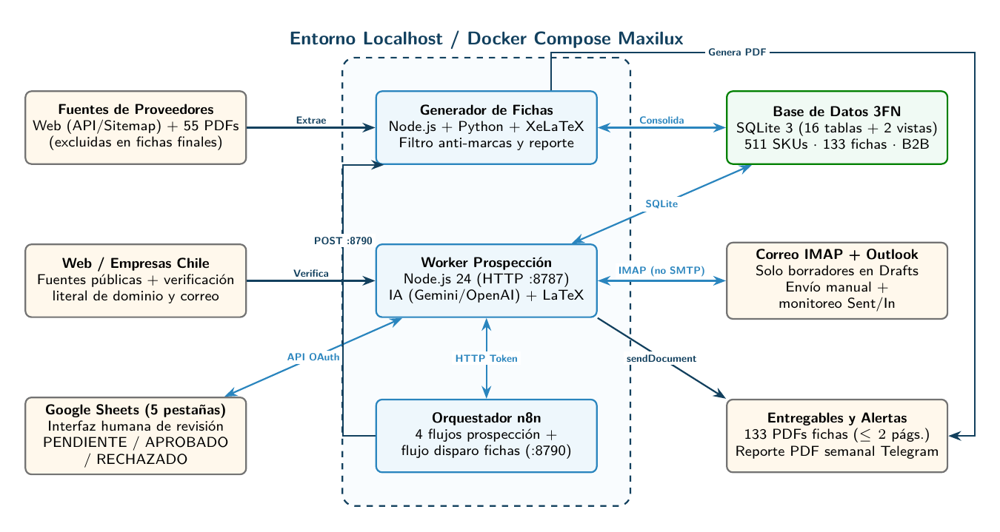

# 05 — Automatización en n8n y Trazabilidad BPMN

## 1. Arquitectura general de automatización

La automatización de Maxilux separa la **orquestación visual en n8n** de la **lógica transaccional, validaciones de seguridad y compilación LaTeX**, evitando código frágil disperso y garantizando idempotencia ante reintentos o cortes de red.

En `automatizacion/` se incluyen los flujos exportados y sanitizados (sin credenciales ni secretos):
- `automatizacion/prospeccion/flujos/` (configuración Docker `http://worker:8787`) y `flujos-local/` (configuración Windows localhost `http://127.0.0.1:8787`):
  - `01_prospeccion.json`
  - `02_borradores.json`
  - `03_seguimiento.json`
  - `04_resumen.json`
- `automatizacion/fichas/`:
  - `Maxilux_Generar_Fichas.json` (disparador de la versión productiva actual sobre la base consolidada)
  - `Maxilux_Fichas_n8n.json` (prototipo v1 por URL/PDF individual en Google Sheets, conservado como antecedente técnico)

---

## 2. Módulo A — Prospección B2B en n8n (4 flujos encadenados por estado)

Todos los flujos de prospección se autentican mediante cabecera `x-maxilux-key` (`Header Auth`), pasan un `x-maxilux-run` correlativo entre etapas y operan bajo un **bloqueo exclusivo (`locks`) de 15 minutos** en SQLite para impedir condiciones de carrera.

### Trazabilidad Nodo n8n ↔ Tarea BPMN TO-BE

| Flujo JSON | Trigger | Nodos principales en n8n | Tarea BPMN TO-BE asociada | Regla crítica aplicada |
|---|---|---|---|---|
| `01_prospeccion.json` | Manual (`manualTrigger`) | `Leer decisiones y aplicar bloqueos` → `Calcular cupo disponible` → `If ¿Hay cupo?` → `Buscar empresas con IA` → `Validar correos y fuentes` → `Redactar y registrar prospectos` → `Actualizar Prospectos en Sheets` | *Sincronizar decisiones y bloqueos / Evaluar cupo < 100 / Buscar máx. 10 empresas / Verificar dominio y correo / Publicar como PENDIENTE* | Tope estricto de **100 pendientes iniciales**; si `slots === 0` no llama a la API de IA. El correo debe existir **literalmente en el HTML del mismo dominio** de `website` (`safeFetch` bloquea IPs privadas). |
| `02_borradores.json` | Manual (`manualTrigger`) | `Leer decisiones y aplicar bloqueos` → `Identificar aprobados sin borrador` → `If ¿Hay aprobados?` → `Recuperar o crear borradores` → `Registrar borradores en Sheets` | *Crear/recuperar borrador IMAP (sin envío auto) / Registrar ID en Sheets* | Solo procesa filas con `Decisión = APROBADO`. `DELIVERY_MODE=drafts` forzado: usa IMAP `APPEND \Draft` con `Message-ID` determinista (`draftKey`) para recuperar el borrador sin duplicar si falla la escritura en Sheets. |
| `03_seguimiento.json` | Manual + Cron `*/15 * * * *` | `Leer decisiones y aplicar bloqueos` → `Leer Entrada y Enviados` → `Registrar respuestas, envíos y bajas` → `Calcular seguimientos vencidos` → `If ¿Hay seguimientos vencidos?` → `Redactar y dejar en revisión` → `Actualizar Seguimientos en Sheets` | *Leer Sent e INBOX / Registrar envíos, respuestas y bajas / Evaluar >= 3 días hábiles / Encolar máx. 1 seguimiento* | Lectura pasiva IMAP (`BODY.PEEK`, no marca mensajes como leídos). Ignora respuestas automáticas (`Auto-Submitted`), registra bajas por palabras clave o rebote DSN (`REJECTED`/`BOUNCE` → bloqueo permanente) y genera **máximo 1 seguimiento** en `PENDIENTE`. |
| `04_resumen.json` | Manual + Cron `0 8 * * 0` (dom. 08:00 CL) | `Leer decisiones y aplicar bloqueos` → `Determinar período del reporte` → `If ¿Falta entregar?` → `Calcular indicadores y detalle` → `Compilar el PDF` → `Entregar PDF por Telegram` → `Cerrar y actualizar Actividad` | *Compilar PDF LaTeX desde SQLite / Enviar a Telegram* | **No consume API de IA.** Compila primero el PDF con `pdflatex` (`-no-shell-escape`) y solo después invoca `sendDocument` de Telegram con control `uncertain` para evitar reportes duplicados. |

### Interfaz humana de revisión en Google Sheets (`Maxilux - Prospección B2B`)
- **Pestañas:** `Prospectos`, `Seguimientos`, `Bloqueadas`, `Actividad`, `Configuracion`.
- **Control de columnas:** Solo 4 columnas son editables por el usuario (`C Decisión`, `H Asunto`, `I Correo sugerido`, `J Notas de revisión`); las columnas de sistema (`K`–`S`) se actualizan con `valueInputOption=RAW` para evitar inyección de fórmulas.

---

## 3. Módulo B — Generación de Fichas Técnicas (`Maxilux_Generar_Fichas.json`)

| Flujo JSON | Trigger | Nodos principales | Tarea BPMN TO-BE | Función ejecutada |
|---|---|---|---|---|
| `Maxilux_Generar_Fichas.json` | Manual | `Ejecutar` → `POST http://127.0.0.1:8790/generar` (`Generar fichas`) | *Ejecutar flujo n8n → Fusionar Base → Filtrar marcas → Compilar XeLaTeX → Reporte de brechas* | Invoca el servicio local `servicio.cjs`, el cual ejecuta `generar.js` leyendo la base consolidada (511 SKUs), aplicando reglas de agrupación por producto/IP/medida, filtrando marcas ocultas y compilando **133 PDFs ≤ 2 páginas** + `reporte.xlsx`. |

### Evolución respecto del prototipo inicial (`Maxilux_Fichas_n8n.json`)
El prototipo v1 (34 nodos n8n nativos) se probó satisfactoriamente con fuentes externas de referencia, pero en producción real sobre los **55 PDFs de proveedores** aceptó solo 27 por formatos irregulares y asignaba SKUs ficticios (`MX-CAM-0001`). Por ello se adoptó el generador consolidado (`generador/` + disparo HTTP desde n8n), que unifica el catálogo real `MX-1000..MX-1510` con 28 pruebas unitarias automatizadas aprobadas.

---

## 4. Mejoras incorporadas en la entrega final de prospección

Al auditar el paquete original antes de su puesta en marcha en la cuenta del equipo, se corrigieron cinco puntos críticos:
1. **Catálogo completo en prompts y skill:** Se ampliaron las 6 líneas iniciales a las **14 familias reales** (incorporando Solar y Batería — 22,7% del catálogo — y Alumbrado Público/Postes) y sus rubros asociados (municipalidades, constructoras, condominios, parques industriales).
2. **Razonamiento y presupuesto API ajustados:** Se mantuvo el proveedor/modelo nativo `openai` + `gpt-6-luna` elevando `reasoning.effort` de `low` a `medium` (con soporte opcional para Gemini) y aumentando el tope mensual `LLM_BUDGET_USD` de `USD 0.50` a `USD 5.00` para operar múltiples lotes sin bloqueos prematuros.
3. **Firma web configurable:** Se parametriza `MAIL_WEBSITE` (vacío mientras no se confirme la publicación activa de `maxilux.cl`, alineado con el generador de fichas).
4. **Limpieza documental:** Se removió una referencia residual a un proyecto externo ajeno en `SKILL.md` y menciones internas de prueba.
5. **Soporte local Windows sin Docker:** Se añadieron flujos en `flujos-local/` apuntando a `http://127.0.0.1:8787` y lanzador `iniciar-local.cmd`, manteniendo los 66 tests unitarios (`npm test`) y validación (`npm run check`) al 100%.
